# How it works story: asset prompts for GPT Image

The story is built from separate pieces that the code positions and animates. Generate every item
as its **own PNG**. Don't make full scenes, because I can't move parts of a flattened picture.

Every prompt below is **complete**: the style prefix is already written in, so copy the whole
block. Under each prompt, **Attach** shows the reference images to upload with it. They're all in
[`docs/hiw-story-refs/`](hiw-story-refs/). Keep generating in one GPT chat so the style stays locked.

| Look | Used for | How it looks |
|---|---|---|
| **Line art** | Buildings, walls, trees, skyline, hills: everything behind the people | Navy ink lines, flat cream fill inside shapes, no colour, no shading. I recolour it to soft grey and thin the lines afterwards, so keep generating in navy. |
| **Character style** | People, props they touch, plants in front | The style of the Rekha and Arjun sheets: flat warm colours, soft grain, chunky friendly shapes |

Scale guide: Rekha standing is **1R** tall. Arjun standing is **1A**, drawn about 1.8× taller on
screen. Sizes are approximate (I scale in code), but proportions matter.

---

## 1. Rules for every image (removal and clean-up)

Check each PNG against this list before sending it:

1. **Real transparency.** No white box, no halo, and no fake grey checkerboard baked into the
   pixels. The shop and both machines came back with one, especially on EDITs.
2. **No ground or floor** under the object. I draw the ground in code.
3. **No shadows** of any kind. I add these in code.
4. **No people** in prop or background images.
5. **No text**, except where a prompt asks for a sign. No watermarks.
6. **Straight side view** at eye level, with a flat horizontal bottom edge so it sits on my ground line.
7. **Crop tight**, with about 2% padding. At least 1536 px on the longest side.
8. **Several items on one sheet:** leave clear empty space between them, so I can split them automatically.
9. **Line art only:** fill closed shapes with solid cream (not transparent), make glass fully
   transparent, and draw lines in one navy colour at one even weight.
10. **Characters only:** same scale as the reference sheet, with feet flat on one line at the bottom,
    and no furniture, railing or plant in the pose.

---

## 2. Still needed (in priority order)

### R1 `rekha-shop-sew.png`: Rekha sewing at her new shop machine
```text
Flat 2D illustration in exactly the same style as the attached reference images: warm flat colours, subtle paper grain, soft rounded chunky shapes, thin darker outlines only where colours meet, gentle highlights, no heavy shading. Straight-on side view, eye-level. Transparent background, no ground, no floor, no shadow, no text.

EDIT the attached shop sewing table: keep the treadle table, the black sewing machine, the stool and the stack of folded fabric exactly the same size and in exactly the same position. Add Rekha, the same character as the attached Rekha sheet (pink kurta, cream salwar, red dupatta, hair in a bun, bindi, gold earrings), sitting on the stool, seen from the side facing right, both hands guiding white cloth under the needle, one foot on the treadle, with a proud, content smile.
```
**Attach:**
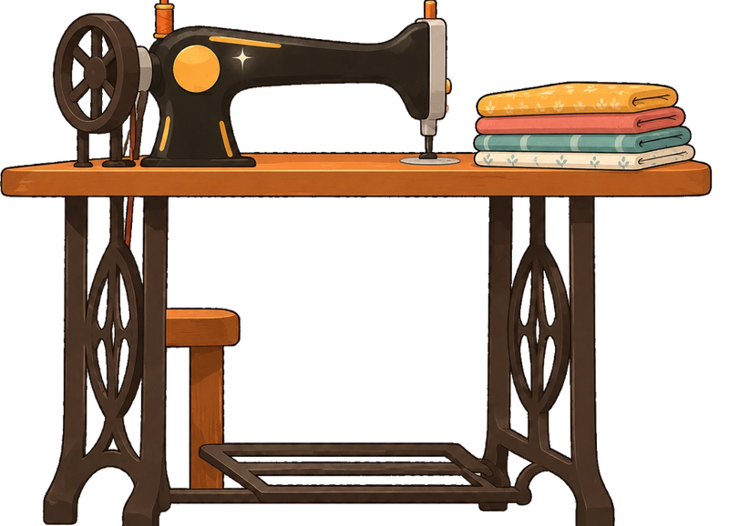 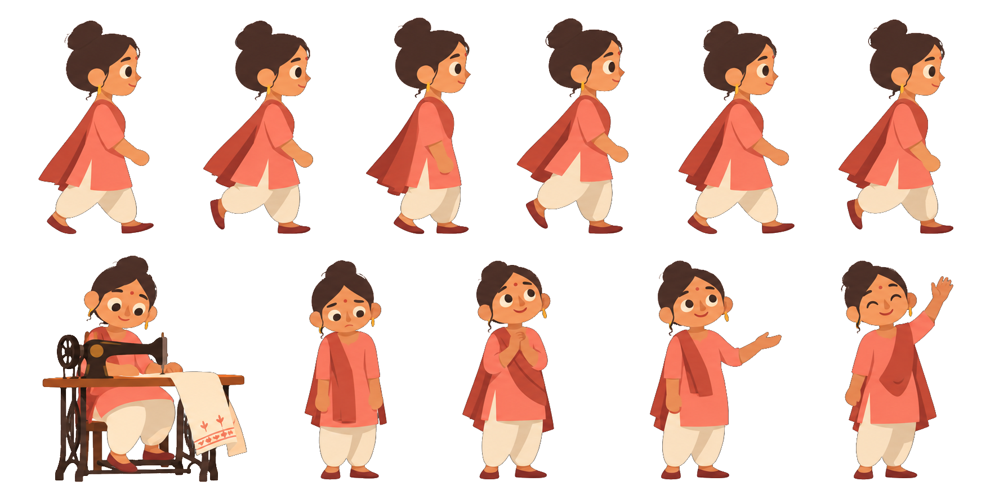

**Must match:** the table must not move, because she switches from standing to sewing with a crossfade.

### R2 `customer.png`: a customer collecting her order (6 walk frames + 2 poses)
```text
Flat 2D illustration in exactly the same style as the attached reference sheets: warm flat colours, subtle paper grain, soft rounded chunky shapes, thin darker outlines only where colours meet, gentle highlights, no heavy shading. Eye-level. Transparent background, no ground, no floor, no shadow, no text.

A new character for the same Rajasthani village: an older woman, a customer, clearly different from Rekha. Mustard-yellow ghagra, a deep-blue odhni over her head, silver bangles, a cloth bag on her shoulder, a warm round face. Same height and proportions as Rekha in the attached sheet. One sheet, with clear empty space between every figure:
- Top row: a 6-frame side-view walk cycle facing LEFT, evenly spaced, in the same layout as the Rekha walk row.
- Bottom row: (a) standing, holding out both hands to receive a folded kurta; (b) standing, holding a neatly folded coral kurta against her chest, delighted.
```
**Attach:**
 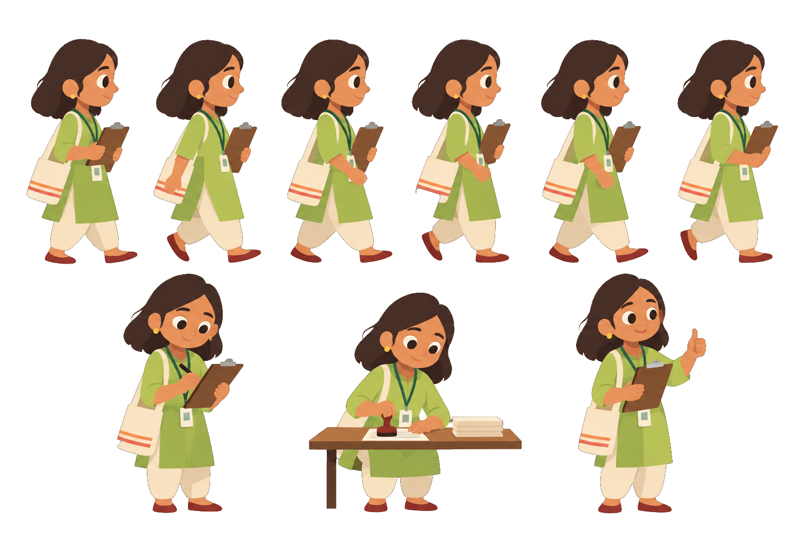

**Where it goes:** in scene 8 she walks into Rekha's shop, takes a kurta and leaves happy. That shows where Rekha's repayments come from.

### R3 `arjun-think.png`: Arjun wondering about his savings
```text
Flat 2D illustration in exactly the same style as the attached Arjun sheet: warm flat colours, subtle paper grain, soft rounded chunky shapes, thin darker outlines only where colours meet, gentle highlights, no heavy shading. Eye-level. Transparent background, no ground, no floor, no shadow, no text, no furniture.

Same Arjun as the attached sheet, same outfit, proportions and scale (blue sweater, white collar, black trousers, white sneakers, round glasses). Standing, front three-quarter view, one hand on his chin, the other loosely holding his phone at his side, looking up and to the side, mildly puzzled.
```
**Attach:**
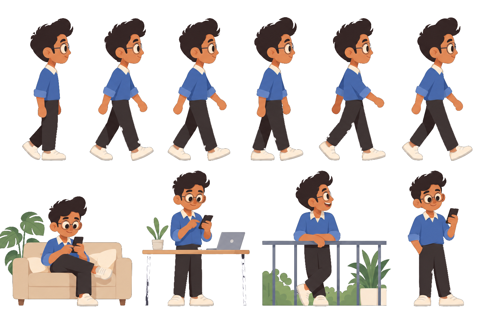

**Where it goes:** the opening scene, with the existing thought bubble showing a "3%" savings passbook.

### R4 + R5 `arjun-reactions.png`: Arjun cheering and tapping (2 poses on one sheet)
```text
Flat 2D illustration in exactly the same style as the attached Arjun sheet: warm flat colours, subtle paper grain, soft rounded chunky shapes, thin darker outlines only where colours meet, gentle highlights, no heavy shading. Eye-level. Transparent background, no ground, no floor, no shadow, no text, no furniture.

Same Arjun as the attached sheet, same outfit, proportions and scale. Two separate standing poses on one sheet, with clear empty space between them:
(a) holding his phone up in one hand and making a small happy fist pump with the other, eyes squeezed shut with joy;
(b) looking down at his phone, tapping the screen with his thumb, a small focused smile.
```
**Attach:**


**Where they go:** (b) when he picks ₹5,000 and taps Lend, and (a) when the loan is fully funded and when the last repayment lands.

### R6 `customer-pay.png`: the customer paying Rekha (1 pose)
```text
Flat 2D illustration in exactly the same style as the attached customer sheet: warm flat colours, subtle paper grain, soft rounded chunky shapes, thin darker outlines only where colours meet, gentle highlights, no heavy shading. Eye-level. Transparent background, no ground, no floor, no shadow, no text.

The same customer as the attached sheet (mustard ghagra, deep-blue odhni, silver bangles, cloth bag), same height and scale as her standing poses. Standing, facing RIGHT, holding out a small fold of rupee notes in one hand towards someone in front of her, the other hand on her bag strap, a friendly smile.
```
**Attach:**
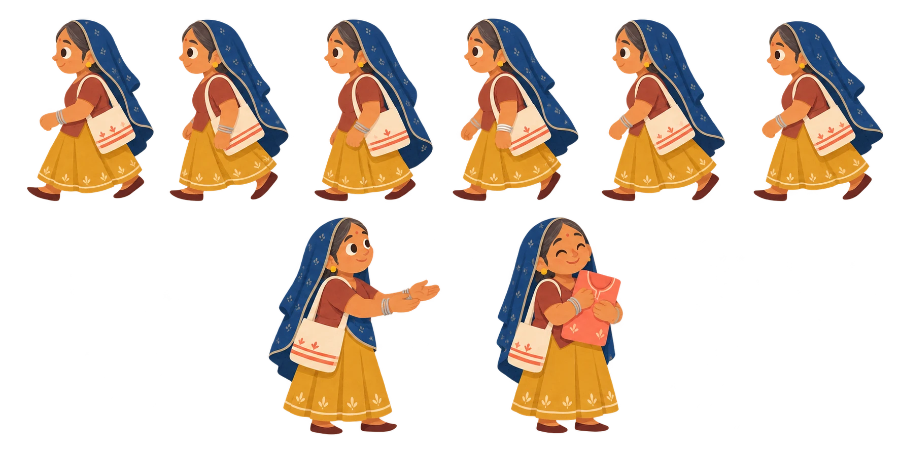

**Where it goes:** scene 8. She pays Rekha before she takes her kurta, and *then* Rekha's monthly repayment flies to Arjun. Right now the repayment coins launch from the spot where the customer stands, so it isn't clear that her money is what pays Arjun back.

### R7 `icon-idle-savings.png`: what Arjun is thinking about (1 small icon)
```text
Flat 2D illustration in exactly the same style as the attached reference sheets: warm flat colours, subtle paper grain, soft rounded chunky shapes, thin darker outlines only where colours meet. Transparent background, no ground, no shadow, no text, no numbers.

A small, slightly sad-looking piggy bank sitting still, with a single cobweb strand from its ear to the floor and two tiny dust motes floating above it: money that is just sitting there. Square composition, the piggy bank filling most of the frame.
```
**Attach:**
 

**Where it goes:** inside Arjun's thought bubble in the opening, which is empty right now.

### R8 `officer-rangde.png`: the field partner, visibly from Rang De (EDIT of her sheet)
```text
Flat 2D illustration in exactly the same style as the attached field partner sheet. EDIT the attached sheet: keep every pose, the canvas and all positions exactly the same. Only change her ID lanyard: make the strap a bright Rang De blue (#0DAADE) and give the ID card a small white rounded tab with a simple multicolour tree-and-roots mark on it, like the attached Rang De logo, so she reads as a Rang De field partner at a glance. No words on the card.
```
**Attach:**
 (plus the Rang De logo from the site header)

**Where it goes:** everywhere she appears. Nothing ties her to Rang De until her caption says so.

### V5 `village-lane.png`: lane wall and electric pole (about 3R wide × 1.1R tall)
```text
Clean flat vector line illustration for a children's-storybook-style explainer website, in exactly the same style as the attached line-art pieces. Single navy ink colour #1B2A4A, uniform medium stroke weight, rounded line caps, no hatching, no shading, no gradients, no texture. Every closed shape filled with flat solid cream #FBF1E2. Straight-on side elevation, eye-level, no perspective. Isolated object on a transparent background, no ground, no shadow, no people, no text.

A long, low, rough stone boundary wall about knee high, drawn in two rows of uneven rectangular stones. At the far right, a thin wooden electricity pole with one crossbar and a single wire drooping off to the left.
```
**Attach:**
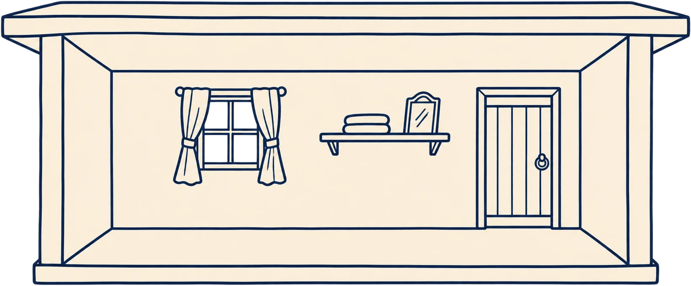 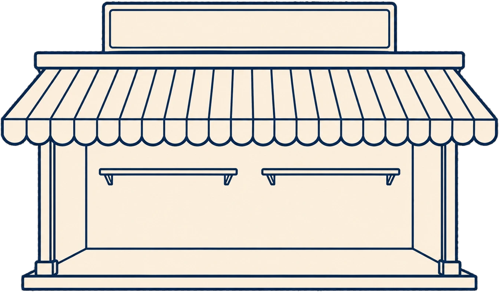

---

## 3. Already delivered (kept here so any piece can be regenerated)

### Village line art

#### V1 `village-home.png`: Rekha's home, cutaway ✅
```text
Clean flat vector line illustration for a children's-storybook-style explainer website. Single navy ink colour #1B2A4A, uniform medium stroke weight, rounded line caps, no hatching, no shading, no gradients, no texture. Every closed shape filled with flat solid cream #FBF1E2. Straight-on side elevation, eye-level, no perspective. Isolated object on a transparent background, no ground, no shadow, no people, no text.

A small single-room rural Rajasthani house shown as a cutaway: the front wall is removed so we look straight into the room. A flat concrete roof slab overhangs both sides; two short side walls are visible at the edges with slight thickness. On the back wall: one small square window with two simple curtains tied to the sides (window panes transparent), and a plain wooden door on the right. A shelf with two folded cloth bundles and a small mirror on the back wall. The room is EMPTY in the middle and left: no furniture, no table, no sewing machine.
```
**Delivered:** 

#### V2 / V3 bank, shutter open and shut ✅
```text
Clean flat vector line illustration for a children's-storybook-style explainer website. Single navy ink colour #1B2A4A, uniform medium stroke weight, rounded line caps, no hatching, no shading, no gradients, no texture. Every closed shape filled with flat solid cream #FBF1E2. Straight-on side elevation, eye-level, no perspective. Isolated object on a transparent background, no ground, no shadow, no people.

A small, formal village bank branch building: a flat roof with a raised rectangular sign board on top that reads "BANK" in simple bold capital letters, a wide front window with a counter ledge below it, and a narrow door on the right. A metal roll-up shutter box above the window.
- Version 1: the shutter is fully rolled UP (window open, glass transparent).
- Version 2: identical building, same framing and size, but the roll-down shutter is fully DOWN over the window, drawn as horizontal slats.
```
**Delivered:** 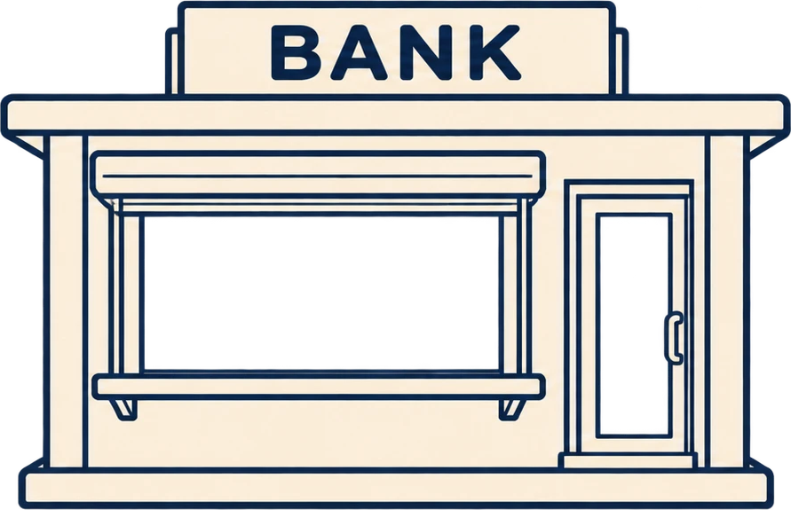 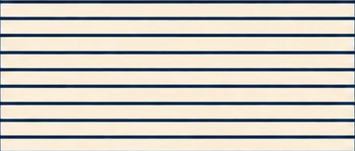

#### V4 `village-tree.png`: neem tree ✅
```text
Clean flat vector line illustration for a children's-storybook-style explainer website. Single navy ink colour #1B2A4A, uniform medium stroke weight, rounded line caps, no hatching, no shading, no gradients, no texture. Every closed shape filled with flat solid cream #FBF1E2. Straight-on side elevation, eye-level, no perspective. Isolated object on a transparent background, no ground, no shadow, no people, no text.

A large, wide, shady neem tree with a cloud-like bumpy canopy made of several rounded lobes, a short thick trunk splitting into two main branches. The canopy is filled cream, with a few inner lobe outlines suggesting depth. Nothing under it: no charpai, bench or person.
```
**Delivered:** 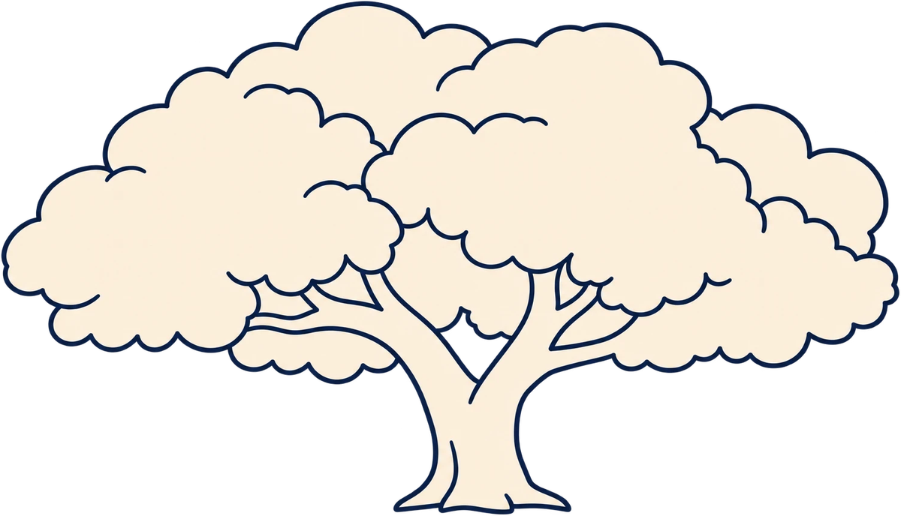

#### V6 `village-shop.png`: Rekha's tailor shop ✅
```text
Clean flat vector line illustration for a children's-storybook-style explainer website. Single navy ink colour #1B2A4A, uniform medium stroke weight, rounded line caps, no hatching, no shading, no gradients, no texture. Every closed shape filled with flat solid cream #FBF1E2. Straight-on side elevation, eye-level, no perspective. Isolated object on a transparent background, no ground, no shadow, no people, no text.

A small roadside tailor shop with an open front: a scalloped fabric awning with vertical stripes (stripes as lines only), two slim side posts, a plain back wall with two empty hanging rails, and a blank rectangular sign board on the roof (leave the board EMPTY, no letters). No counter, table, sewing machine or clothes.
```
**Delivered:** 

#### V7 `village-hills.png`: far hills strip (must tile) ✅
```text
Clean flat vector line illustration for a children's-storybook-style explainer website. Single light grey-blue line colour #B4BFD3, uniform medium stroke weight, rounded line caps, no hatching, no shading, no gradients, no texture. Closed shapes filled with flat solid cream #FBF1E2. Straight-on side view, eye-level, no perspective. Transparent background, no ground, no shadow, no people, no text.

A long, gentle, low line of Rajasthani hills and dunes on the horizon, with three or four tiny distant huts and one or two tiny trees. Very sparse. The left and right edges must join seamlessly when repeated side by side.
```
**Delivered:** 

#### V8 clouds (3 on one sheet) ✅
```text
Clean flat vector line illustration for a children's-storybook-style explainer website. Single light grey-blue line colour #B4BFD3, uniform medium stroke weight, rounded line caps, no shading, no gradients, no texture. Filled with flat white. Transparent background, no text.

Three small, simple, puffy clouds of different sizes, well spaced apart on one transparent canvas.
```
**Delivered:**   

### Flat line art

#### F1 `flat-window.png`: living-room window wall ✅
```text
Clean flat vector line illustration for a children's-storybook-style explainer website. Single navy ink colour #1B2A4A, uniform medium stroke weight, rounded line caps, no hatching, no shading, no gradients, no texture. Every closed shape filled with flat solid cream. Straight-on elevation, eye-level, no perspective. Transparent background, no shadow, no people, no text.

A section of a modern apartment living-room wall seen straight on, with one large three-panel window (all glass panes fully transparent) with a slim window sill. A plain skirting line near the bottom edge.
```
**Delivered:** 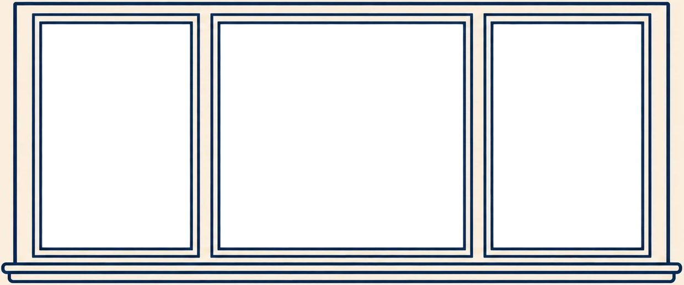

#### F2 `flat-balcony.png`: open balcony door and railing ✅
```text
Clean flat vector line illustration for a children's-storybook-style explainer website. Single navy ink colour #1B2A4A, uniform medium stroke weight, rounded line caps, no hatching, no shading, no gradients, no texture. Every closed shape filled with flat solid cream. Straight-on elevation, eye-level, no perspective. Transparent background, no shadow, no people, no text.

A tall glass balcony door frame, one door panel swung open inward (shown as a thin angled panel at the left), and beyond it a simple balcony railing with a top rail and evenly spaced vertical bars. All glass and the space between the railing bars must be transparent.
```
**Delivered:** 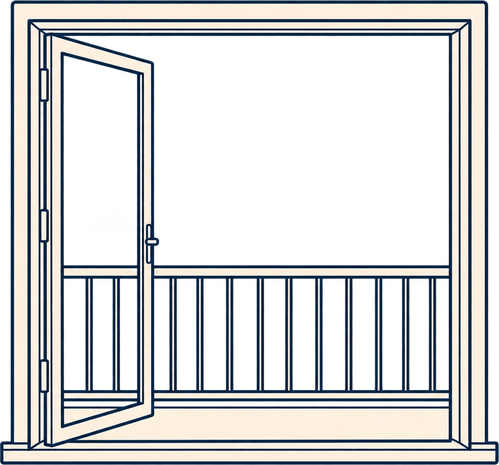

#### F3 wall decor (2 frames + clock on one sheet) ✅
```text
Clean flat vector line illustration for a children's-storybook-style explainer website. Single navy ink colour #1B2A4A, uniform medium stroke weight, rounded line caps, no hatching, no shading, no gradients, no texture. Every closed shape filled with flat solid cream. Straight-on, eye-level. Transparent background, no shadow, no text.

A tall rectangular picture frame with a tiny mountain sketch inside, a small square frame with a single circle inside, and a round wall clock. Well spaced on one transparent canvas.
```
**Delivered:** 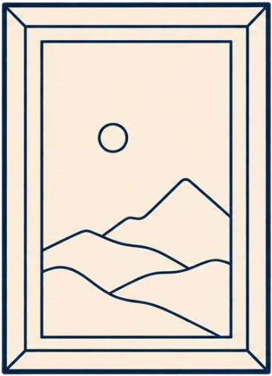 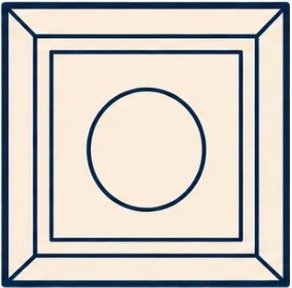 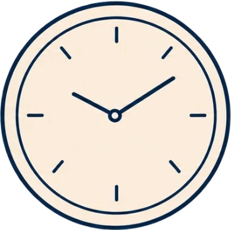

#### F4 `flat-skyline.png`: city skyline (must tile) ✅
```text
Clean flat vector line illustration for a children's-storybook-style explainer website. Single light grey-blue line colour #B4BFD3, uniform medium stroke weight, rounded line caps, no hatching, no shading, no gradients, no texture. Closed shapes filled with flat light blue #DCE7F5. Straight-on, eye-level, no perspective. Transparent background, no ground, no shadow, no text.

A Bengaluru city skyline of mixed modern towers and mid-rises, a few with small window grids, and a couple of rounded tree tops at the base. Flat, simple, airy. The left and right edges must join seamlessly when repeated.
```
**Delivered:** 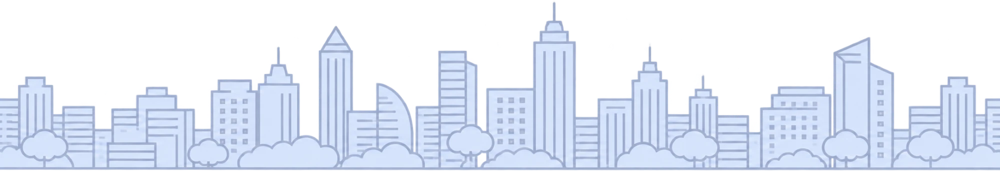

### Props (character style)

#### P1 `prop-sofa.png` ✅
```text
Flat 2D illustration in exactly the same style as the attached reference sheets (Rekha, Arjun, sewing table): warm flat colours, subtle paper grain, soft rounded chunky shapes, thin darker outlines only where colours meet, gentle highlights, no heavy shading. Straight-on side view, eye-level. Isolated on a transparent background, no ground, no floor, no shadow, no text.

A modern three-seater fabric sofa in soft dusty blue with slightly lighter back cushions, rounded arms, short dark wooden legs, and one mustard throw cushion. Front view.
```
**Attach:**   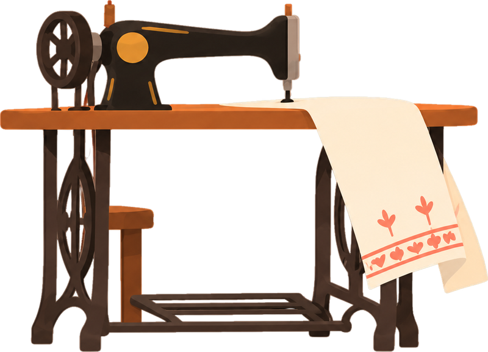 · **Delivered:** 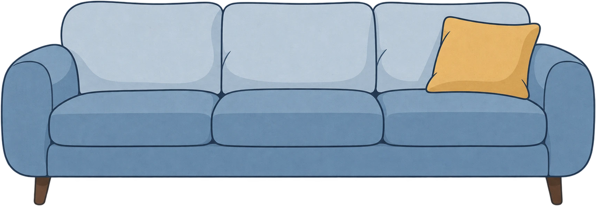

#### P2 `prop-desk.png` ✅
```text
Flat 2D illustration in exactly the same style as the attached reference sheets (Rekha, Arjun, sewing table): warm flat colours, subtle paper grain, soft rounded chunky shapes, thin darker outlines only where colours meet, gentle highlights, no heavy shading. Straight-on side view, eye-level. Isolated on a transparent background, no ground, no floor, no shadow, no text.

A simple light-wood work desk with thin legs; on it an open silver laptop (screen facing left, so we see its back) and a terracotta coffee mug. In front of it, slightly to the right, a grey-blue office chair on a five-star base with wheels. Side view.
```
**Attach:**   · **Delivered:** 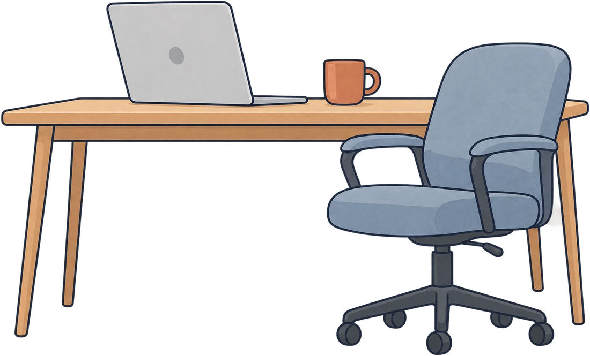

#### P3 `prop-balcony-plant.png` ✅
```text
Flat 2D illustration in exactly the same style as the attached reference sheets (Rekha, Arjun, sewing table): warm flat colours, subtle paper grain, soft rounded chunky shapes, thin darker outlines only where colours meet, gentle highlights, no heavy shading. Straight-on side view, eye-level. Isolated on a transparent background, no ground, no floor, no shadow, no text.

A terracotta pot with a lush leafy plant (long pointed leaves, sage and deep green).
```
**Attach:**  · **Delivered:** 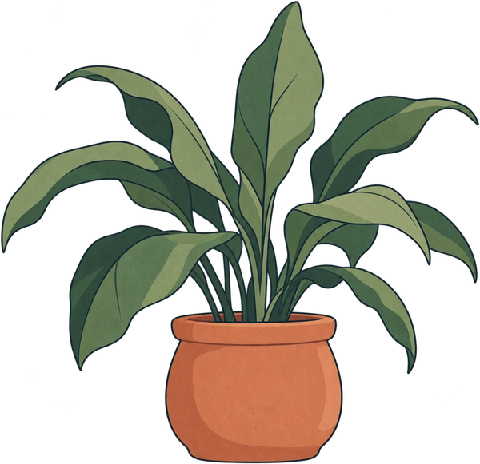

#### P4 `prop-charpai.png` ✅
```text
Flat 2D illustration in exactly the same style as the attached reference sheets (Rekha, Arjun, sewing table): warm flat colours, subtle paper grain, soft rounded chunky shapes, thin darker outlines only where colours meet, gentle highlights, no heavy shading. Straight-on side view, eye-level. Isolated on a transparent background, no ground, no floor, no shadow, no text.

A traditional Indian charpai (woven rope cot) with turned wooden legs in warm brown and an off-white rope weave, side view.
```
**Attach:**   · **Delivered:** 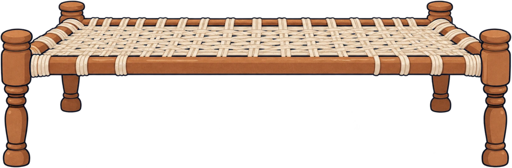

#### P5 `prop-shop-machine.png`: the new machine at her shop ✅
```text
Flat 2D illustration in exactly the same style as the attached sewing table: warm flat colours, subtle paper grain, soft rounded chunky shapes, thin darker outlines only where colours meet, gentle highlights, no heavy shading. Straight-on side view, eye-level. Isolated on a transparent background, no ground, no floor, no shadow, no text.

EDIT the attached sewing table: same treadle table and same black sewing machine, same size and angle, but brand new and shining: add a small sparkle highlight on the machine body, a neat stack of folded colourful fabric on the right end of the table, and remove the draped white cloth.
```
**Attach:**  · **Delivered:** 

#### P6 `prop-machine-broken.png`: the home table, broken ✅
```text
Flat 2D illustration in exactly the same style as the attached sewing table: warm flat colours, subtle paper grain, soft rounded chunky shapes, thin darker outlines only where colours meet, gentle highlights, no heavy shading. Straight-on side view, eye-level. Isolated on a transparent background, no ground, no floor, no shadow, no text.

EDIT the attached sewing table and keep EVERYTHING in the same place and size. Only change: the sewing machine is broken. The drive belt has snapped and hangs loose, the needle is bent, the hand wheel is slightly tilted, and there is a small crack line on the machine body. The cloth stays draped as before.
```
**Attach:**  · **Delivered:** 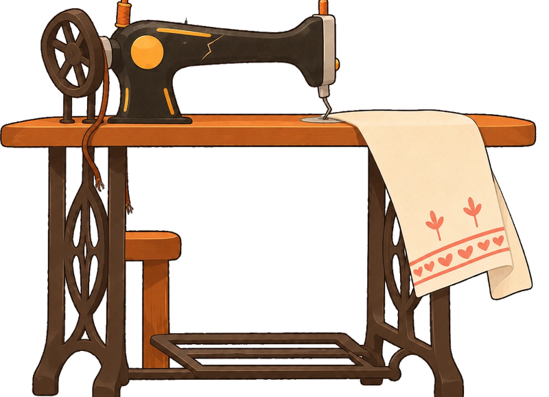

#### P7 foreground bushes (3 on one sheet) ✅
```text
Flat 2D illustration in exactly the same style as the attached reference sheets (Rekha, Arjun, sewing table): warm flat colours, subtle paper grain, soft rounded chunky shapes, thin darker outlines only where colours meet, gentle highlights, no heavy shading. Straight-on side view, eye-level. Isolated on a transparent background, no ground, no floor, no shadow, no text.

Three separate low clumps of wild grass and pointed leaves (sage green, olive, a little dry yellow), of different widths, each with a flat bottom edge. Well spaced on one transparent canvas.
```
**Attach:**  · **Delivered:** 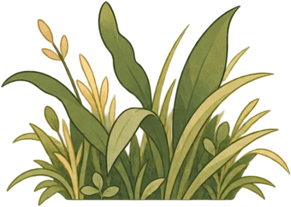

---

## 4. Delivery checklist

- [ ] Every file is a PNG with real transparency (no white box, no baked-in checkerboard)
- [ ] No ground, floor, shadow or stray text
- [ ] EDITs keep the original's table, machine and canvas exactly where they were
- [ ] Sheets with several items have clear empty space between them
- [ ] Characters match their reference sheet's scale, with feet on one flat line

Paste them here or drop them into `public/hiw-story/new/`. I'll clean, crop, size and place them.
